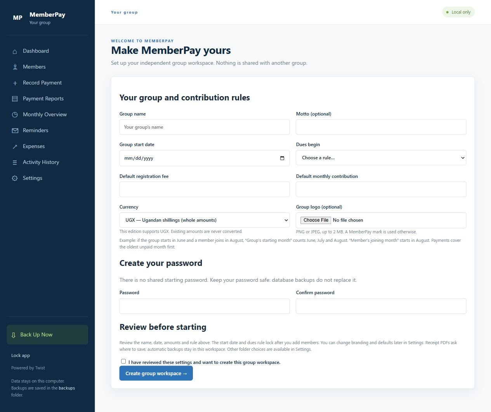

# MemberPay — reusable group edition 1.0.0

**[Download for Windows](https://github.com/twistkan/memberpay/releases/download/v1.0.0-groups/MemberPaySetup.exe)** · [Release notes and checksums](https://github.com/twistkan/memberpay/releases/tag/v1.0.0-groups)

[](https://www.yotip.me/twistkan)

An offline Windows app for member contributions, registration fees, receipts,
statements, reminders, expenses and activity history. **Powered by Twist.**

## Screenshot



First-run setup in a fresh group workspace.

## Windows download

Download **MemberPaySetup.exe** from [Releases](https://github.com/twistkan/memberpay/releases/latest).
It creates a **MemberPay Groups** desktop shortcut and opens a required group
setup screen. No Python installation is needed for the packaged app. Windows
10/11 x64 and Microsoft Edge WebView2 Runtime are required.

Program files: `%LOCALAPPDATA%\MemberPayGroups\Application`.
Group records: `%LOCALAPPDATA%\MemberPayGroups\workspace`.

This edition uses a separate path and shortcut from the original Foundry Circle
edition. The installer never searches for or automatically imports another
MemberPay database. Updating program files leaves group records untouched.

## Set up your group

Choose your group's name, optional motto and PNG/JPEG logo, start date,
registration fee, monthly contribution and dues rule. Confirm your choices and
create a password of at least ten characters. No shared password is supplied.
Only a salted password hash is stored. This version supports **UGX in whole
shillings**; it does not convert currencies.

Monthly dues can start from the group's starting month for everyone, or each
member's joining month (no earlier than the group start). Payments cover the
oldest unpaid month first. Start date and dues rule lock once members exist.
Changing group amount defaults affects new members only. Targets and joining
dates lock after payments are recorded for that member, avoiding silent changes
to historical balances. Effective-dated rate changes are not yet supported.

Settings lets you change branding, new-member defaults and your password. Receipt
PDFs ask where to save until a receipt folder is chosen. The app is local to one
computer; another group's installation has its own data. There is no cloud sync
or simultaneous online multiuser service.

## Back up, restore and import

Use **Back Up Now** regularly. Automatic database backups are created when the
desktop app closes; the newest seven automatic backups are retained. Settings
changes and destructive data tools also create safety backups.

Database backups contain group settings, custom logo, members, transactions,
expenses and history. Password hashes are stored separately in `credentials.json`;
restoring a database does not change the destination workspace's password.
On another computer, complete setup and choose a password before restoring.

To adopt an old MemberPay workspace, first back it up in the original app.
Complete setup in this edition, then use **Settings → Restore** to restore the
chosen database. Legacy settings are completed with the shared-start dues rule
and rates inferred from existing members; member records are retained. Upload
the group's own logo in Settings if needed. **Import** copies members/payments
only and preserves the destination group's settings; duplicate IDs are rejected.
Never use another group's real records as a starter template.

The optional demo tool uses clearly marked fictional members and your configured
rates. It works only in an empty workspace.

## Source setup and build

The release was built with Python 3.14 x64 on Windows.

```powershell
py -3.14 -m venv .venv
.\.venv\Scripts\python.exe -m pip install -r requirements-build.lock.txt
.\.venv\Scripts\python.exe make_icon.py
.\.venv\Scripts\python.exe smoke_test.py
.\.venv\Scripts\python.exe test_settings.py
.\.venv\Scripts\python.exe test_finance.py
.\.venv\Scripts\python.exe -m unittest test_setup test_groups -v
powershell -ExecutionPolicy Bypass -File .\build_installer.ps1 -Python .\.venv\Scripts\python.exe
```

The installer is written to `dist/MemberPaySetup.exe`. Build on a clean source
copy. The application spec includes templates, generic static assets and the
app icon; it does not include workspace data. The installer copies only approved
program files. `make_icon.py` generates the original geometric MemberPay mark.

For source-only use, install `requirements.txt` and run `python app.py`.
Advanced isolated testing can set `MEMBERPAY_DATA_DIR` to a separate folder before
launch. A workspace picker for switching several groups in the interface is not
included.

## Repository scope and validation

Live databases, credentials, backups, exports, caches, downloaded dependencies
and historical builds are excluded. Current downloads belong in Releases.
See [VALIDATION.md](VALIDATION.md) for checks actually performed and their limits.
The application's own source has no open-source license granted at this stage.
Third-party licenses retain their own terms; bundled dependency notices are in
`licenses/`.
